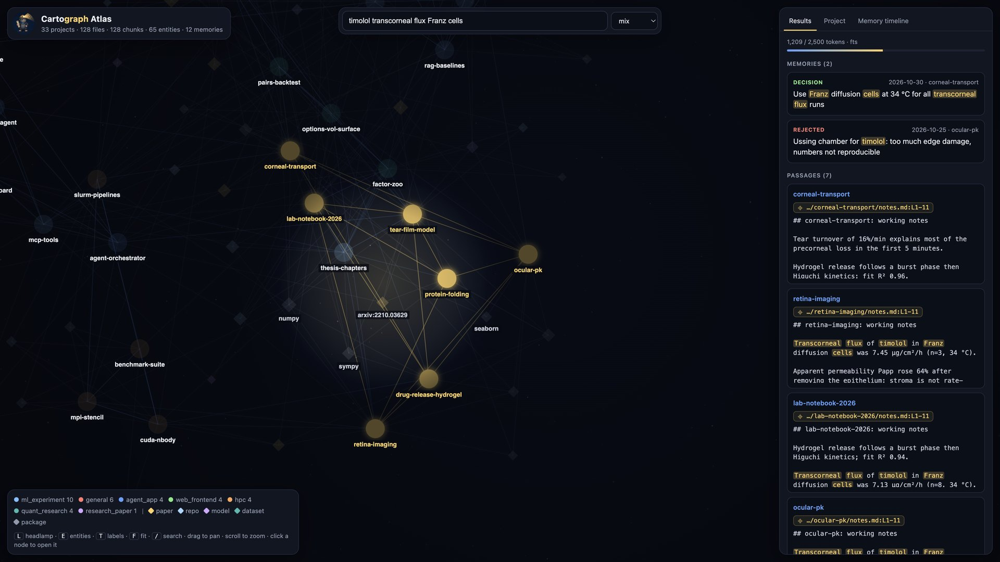
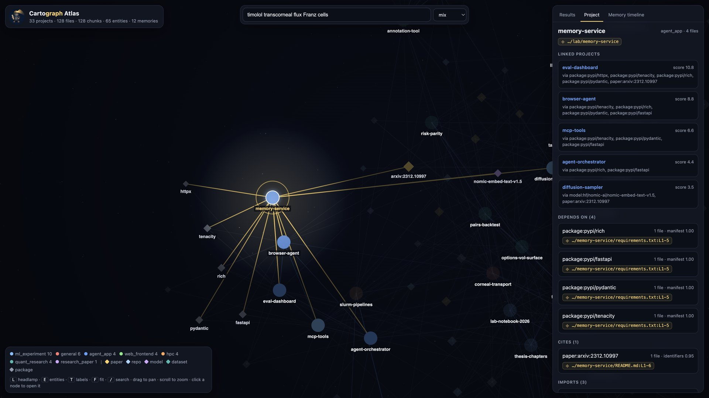
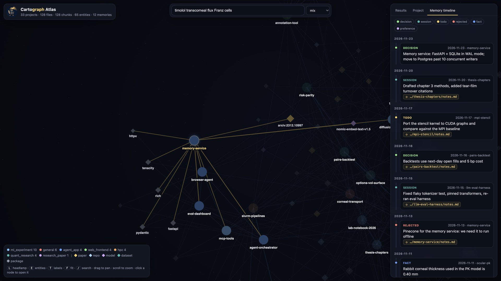

<div align="center">


**A local knowledge graph and shared memory for every AI agent you use.**
Point it at your folders: PDFs, Word, slides, spreadsheets, notebooks, notes and code become one graph
your agents query over MCP, and every answer comes back with the page, slide or line it came from.

[](https://github.com/pbathuri/cartograph/actions/workflows/ci.yml)
[](https://pypi.org/project/cartograph__v1/)
[](https://pypi.org/project/cartograph__v1/)
[](LICENSE)


[Quickstart](#quickstart) · [What you get](#what-you-get) · [Works with](#works-with) ·
[Benchmarks](#benchmarks) · [Compared](#how-it-compares) · [Use cases](#use-cases) · [Atlas](#the-atlas)

</div>

---

## Why

Agents forget. Every new session in Claude Code, Cursor or Codex starts from zero: it doesn't know
your papers, your repos, what you decided last week or which approach you already ruled out. The
usual fixes have a catch. They send your documents to an LLM to build the graph (slow and costly at
scale, and your data leaves the machine), they need a database server, or they answer without saying
where the answer came from.

Cartograph is the boring, dependable version:

- **No LLM needed to build the graph.** Parsing, chunking, entity extraction and linking are
  deterministic. Bring any model you like to *use* it.
- **One SQLite file** in `~/.cartograph`. No Docker, no Neo4j, no vector DB, no account.
- **Every result is citable**: `paper.pdf p.12`, `deck.pptx slide 3`, `train.py:L40-88`,
  `doses.xlsx sheet Doses`, `thesis.docx § Methods`.
- **One memory shared by all your agents.** Decisions, rejected approaches and preferences stay
  valid until they are superseded, and get flagged when the files they point at change.

<table><tr>
<td width="140"></td>
<td>Meet <b>Moley, Your Local Guide</b>. Named for the mole in <i>The Wind in the Willows</i> who catches
the scent of a home he'd forgotten and finds his way back to it, he carries a brass lantern through
your files so your agents don't have to dig, and it only lights up what there's evidence for.
Local, because he never leaves your machine.</td>
</tr></table>

## Quickstart

```bash
pip install "cartograph__v1[docs]"     # core + PDF support. Command: carto. Import: cartograph
carto ingest ~/research ~/code         # incremental: re-run anytime, only changed files are re-read
carto connect all                      # register the MCP server with every AI client it finds
carto viz                              # the Atlas: explore the map, search with citations
```

Add meaning-based search when you want it (uses your GPU if there is one):

```bash
pip install "cartograph__v1[semantic]" && carto index     # resumable; searchable while it builds
```

Then ask your agent anything about your work. It calls `retrieve_context` and gets passages with
citations, the relevant graph facts and your memories, under the token budget you set.

## What you get

| | |
|---|---|
| **Documents with citations** | PDF (pypdf or PyMuPDF, optional OCR), DOCX, PPTX, XLSX, EPUB, HTML, Jupyter, Markdown, LaTeX, BibTeX and 70 code, data and config formats. Chunks never cross page or slide boundaries. |
| **A graph with provenance** | Dependencies from manifests, imports, papers (DOI and arXiv), GitHub repos and Hugging Face models and datasets. Each fact has evidence (a citable chunk), confidence, the extractor that found it, and first and last seen dates. Projects are linked by what they share, weighted by rarity, and each link lists the shared entities. |
| **Temporal memory** | `remember`, `recall`, `supersede` and `brief`. Nothing is overwritten: validity intervals keep the history. You get conflict hints when a new memory contradicts an old one, and staleness flags when anchored files change. Files on an unplugged drive show as *unavailable*, not deleted. |
| **Automatic session capture** | `carto hooks install` for Claude Code, Cursor, Gemini CLI and Codex. Session start injects the project brief. Session end saves the goal, files touched and commands run. Saying `decision: …` or `rejected: …` in chat becomes a memory. |
| **Hybrid retrieval with hard budgets** | Reciprocal-rank fusion of BM25 and embeddings. Modes: `mix`, `chunks`, `projects`, `graph`, `memory`. `max_tokens` is a guarantee, not a hint. |
| **Scales to millions of chunks** | A pure-NumPy IVF-PQ index: 7 ms p50 at 6.5M chunks instead of 8–10 s brute force, with no FAISS and no OpenMP conflicts. Index builds resume after a crash, and you can search while they run. |
| **Honest MCP** | Real JSON Schemas, `readOnlyHint` and `destructiveHint` annotations, `isError` results. `--read-only` hides every tool that writes. |
| **The Atlas** | An offline, interactive map of your graph: headlamp exploration, cited search, project panels with evidence, and a memory timeline. |

## Works with

`carto connect` writes the right config for each client. It backs up the file first and never
rewrites a file that contains comments:

| Client | | Client | |
|---|---|---|---|
| Claude Code | `carto connect claude-code` | Gemini CLI | `carto connect gemini` |
| Claude Desktop | `carto connect claude-desktop` | OpenAI Codex | `carto connect codex` |
| Cursor | `carto connect cursor` | Zed | `carto connect zed` |
| Windsurf | `carto connect windsurf` | Continue | `carto connect continue` |
| VS Code (Copilot agent mode) | `carto connect vscode` | LM Studio | `carto connect lm-studio` |
| Cline | `carto connect cline` | Goose | `carto connect goose --print` |

Any other MCP client: `carto connect cursor --print` shows the JSON to paste. ChatGPT and Gemini on
the web: `carto serve` plus the userscript in [docs/BROWSER.md](docs/BROWSER.md).
Runs on macOS, Linux and Windows with Python 3.10+; CI tests all three operating systems.

<details><summary><b>MCP tools</b></summary>

| Tool | Writes? | What the agent gets |
|---|---|---|
| `retrieve_context` | no | cited passages, or `mode: mix` for memories + facts + passages under `max_tokens` |
| `brief` | no | session-start digest for the project at `cwd`: decisions, rejected approaches, todos, recent sessions |
| `recall` | no | memories by query, project or kind; `history: true` includes superseded ones |
| `entities` | no | what a project depends on, imports, cites; or which projects mention an entity — with evidence |
| `relevant_projects` | no | your projects that relate to a task |
| `personalize` | no | a steering brief from your field and feedback |
| `elevate_task`, `frontier_status`, `frontier_hints` | no | top-of-field reference repos and playbooks |
| `graph_stats` | no | sizes of the graph, entities and memory |
| `remember`, `supersede` | yes | save a decision, preference, fact or todo, or replace one |
| `record_use` | yes | report what helped, so ranking adapts |

</details>

## Benchmarks

Everything below is reproducible with `carto bench`. It runs in a throwaway home and never
touches your graph.

| Suite | Mode | Quality | Latency p50 / p95 |
|---|---|---|---|
| BEIR SciFact (300 queries, 5,183 abstracts) | keyword | nDCG@10 **0.655** · R@100 0.873 · MRR@10 0.622 | 23 / 41 ms |
| BEIR SciFact | hybrid (nomic-embed v1.5) | nDCG@10 **0.709** · R@100 0.938 · MRR@10 0.673 | 70 / 135 ms |
| Citations (240 planted facts in PDF, DOCX, PPTX, MD and PY) | keyword | exact citation@1 **0.992** · hit@5 1.000 | 3 / 7 ms |

For reference, BEIR reports BM25 at 0.665 nDCG@10 on SciFact. The citation suite checks that the top
result is the right file *and* that its citation points at the right page, slide or line. That's what
you need before you trust an answer, and most RAG benchmarks don't measure it.

At scale, on a real 6.5M-chunk, 535k-file graph on an M-series Mac: approximate semantic search takes
**7 ms p50 / 11 ms p95** (brute force: 8–10 s) with tie-aware recall@10 of 0.99. Extracting entities
from all 6.5M chunks takes about 15 minutes.

## How it compares

All of these projects are good, and several inspired parts of Cartograph. They make different
trade-offs. This summary is based on each project's own docs at the time of writing; corrections welcome.

| | Graph built without an LLM | Runs with no servers | Main focus |
|---|---|---|---|
| **Cartograph** | yes | yes (one SQLite file) | your files plus agent memory, with citations |
| Mem0 / OpenMemory | no (LLM extracts memories) | optional | chat and agent memory |
| Graphiti (Zep) | no | no (Neo4j or FalkorDB) | temporal knowledge graph of conversations |
| Cognee | no | yes (embedded defaults) | LLM-built knowledge graphs from data |
| LightRAG | no | yes | graph plus vector RAG |
| Microsoft GraphRAG | no (LLM-heavy indexing) | yes | community summaries over a corpus |
| RAGFlow | partly (parsing is not LLM-based) | no (Docker stack) | deep document understanding |
| Khoj | yes for search; chat needs an LLM | self-hosted server | personal AI assistant |
| Claude Context | yes | no (Milvus or Zilliz + embedding API) | semantic code search over MCP |

Pick Cartograph when you want your agents grounded in *your* documents and decisions, locally, with
citations, at zero indexing cost. Pick an LLM-extraction system when you need open-ended relation
extraction from prose and can pay for it.

## Use cases

- **Research.** Search a library of papers and lab notes; answers cite `paper.pdf p.7`. Projects
  sharing an arXiv paper or dataset are linked automatically. Agents remember which protocol you settled on.
- **Software.** Your repos, their dependencies and imports, and your past decisions: "we rejected
  Redis for this, see the session from March". `brief` greets every new agent session with the
  project's state.
- **Data science.** Notebooks are indexed by cell (`analysis.ipynb cell 4-6`), and spreadsheets by sheet.
  Hugging Face models and datasets become graph entities.
- **Law, policy and consulting.** Long Word and PDF documents with section and page citations you can
  paste into a memo.
- **Students and teaching.** Lecture slides (`slide 12`), readings and assignments in one searchable
  map; works offline.
- **Finance and operations.** Workbooks are searchable by sheet and the reports by page, all on your own machine.

It works the same across fields because nothing is tuned to one domain. Field labels are learned from
your folders (`carto fields`), and the graph is built from file structure, not from a prompt.

## The Atlas

```bash
carto viz
```

An interactive map of your graph that works offline: no CDN, no tracking.



<table><tr>
<td width="50%"></td>
<td width="50%"></td>
</tr></table>

<sub>Screenshots use a synthetic lab (<code>python scripts/atlas_showcase.py</code>), not anyone's real files.</sub>

- **Headlamp** (`L`): the map stays dark and lights up where you point. Labels appear under the lamp.
- **Search** (`/`): matching projects glow and pulse. Results show memories, graph facts and passages,
  each with a citation chip; click it to copy `path:L12-48`.
- **Project panel**: click a node to see its dependencies, citations and references with evidence,
  linked projects and the entities that link them, and its memories.
- **Memory timeline**: every decision, rejection and session in order. Superseded entries are struck through.
- Entity hubs (papers, repos, models, datasets shared by several projects) show as diamonds (`E` toggles them).

## Robustness

- **Incremental and exact.** Files are hashed in full. Unchanged files are skipped by size and mtime
  without being read, and older graphs migrate in place.
- **Crash-safe indexing.** A killed `carto index` resumes from the rows already written.
  `carto index --background` detaches it, and `carto index --status --watch` shows progress.
- **External drives.** Files on an unmounted drive are reported as unavailable rather than deleted,
  so memory anchors and citations survive a missing USB disk.
- **Bad files.** An unreadable PDF or a corrupt DOCX is skipped without stopping the ingest.
- **Safe config edits.** `connect` and `hooks` back up every file they touch, are idempotent, and
  can be undone (`--remove`, `hooks uninstall`).

## Install options

| Install | Adds |
|---|---|
| `pip install cartograph__v1` | graph, keyword search, Office, EPUB and HTML, memory, MCP, Atlas. A small install with no ML. |
| `[docs]` | PDF text with page citations (`pypdf`; PyMuPDF is used if present, plus OCR with `ocr: true`) |
| `[semantic]` | embeddings and hybrid search (sentence-transformers; CUDA or Apple GPU if available) |
| `[ml]`, `[vision]`, `[secure]` | train models on your graph, screen capture to OCR, at-rest encryption |
| `[full]` | everything |

Put the graph on a roomy drive with `CARTOGRAPH_HOME=/path`. See [docs/SCALING.md](docs/SCALING.md)
and [docs/ARCHITECTURE.md](docs/ARCHITECTURE.md).

## Commands

```
ingest · index · retrieve · entities · memory add|recall|supersede|forget|brief · hooks install|status
connect · viz · studio · serve · bench · stats · doctor · mcp-server · demo · init · improve · eval
```

Run `carto <command> --help` for details. Changes are in [CHANGELOG.md](CHANGELOG.md).

## Privacy

Everything lives in `~/.cartograph` (or `CARTOGRAPH_HOME`). Nothing is uploaded, and there is no telemetry.
The local web server binds to loopback, checks the Host header against DNS rebinding, and requires a
token for anything that writes.

## License

MIT. See [LICENSE](LICENSE).
